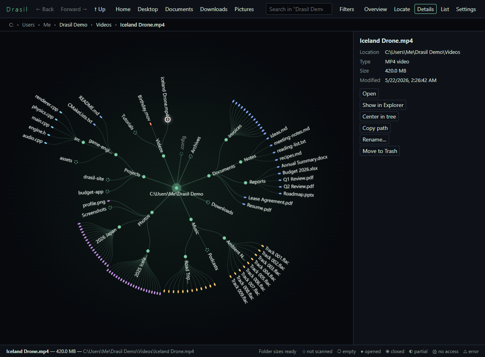
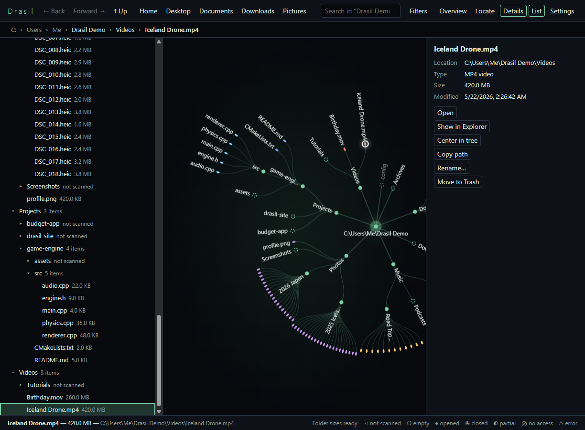
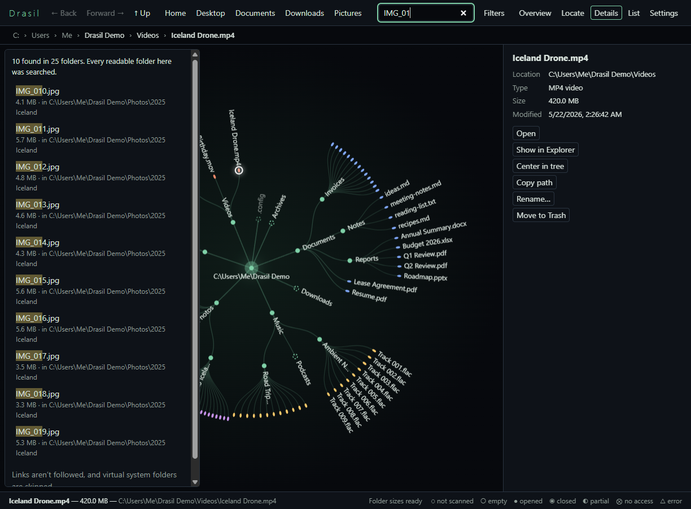
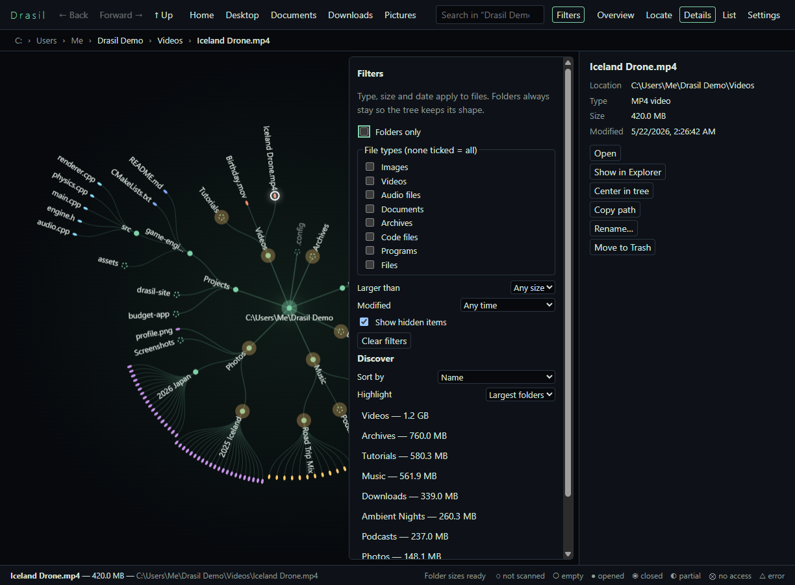
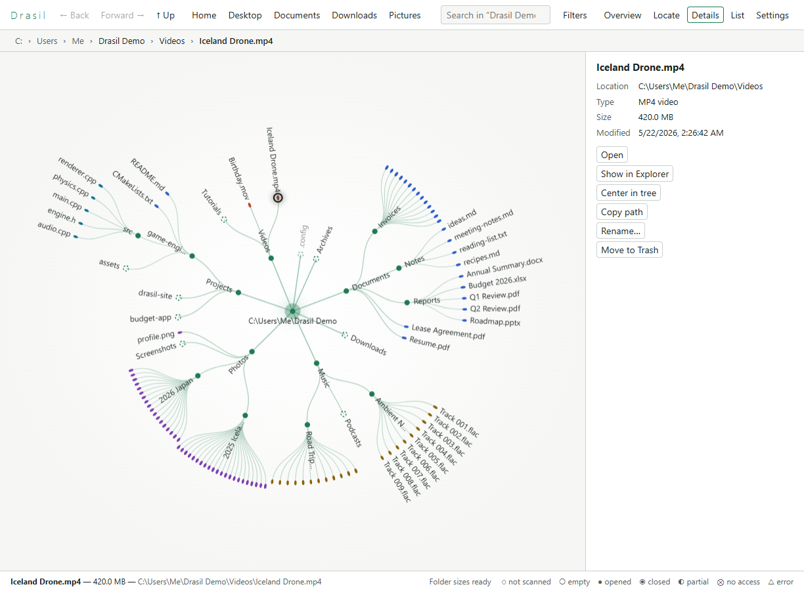
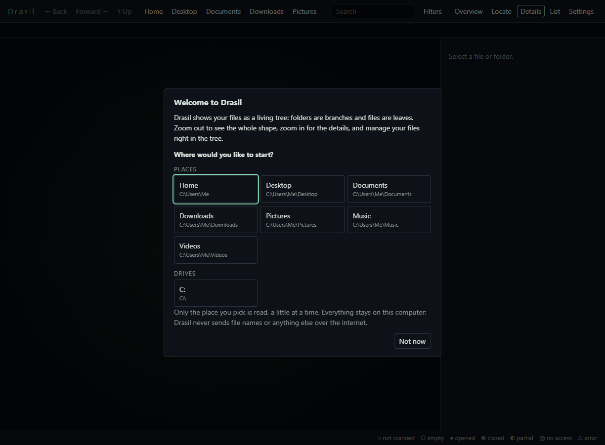
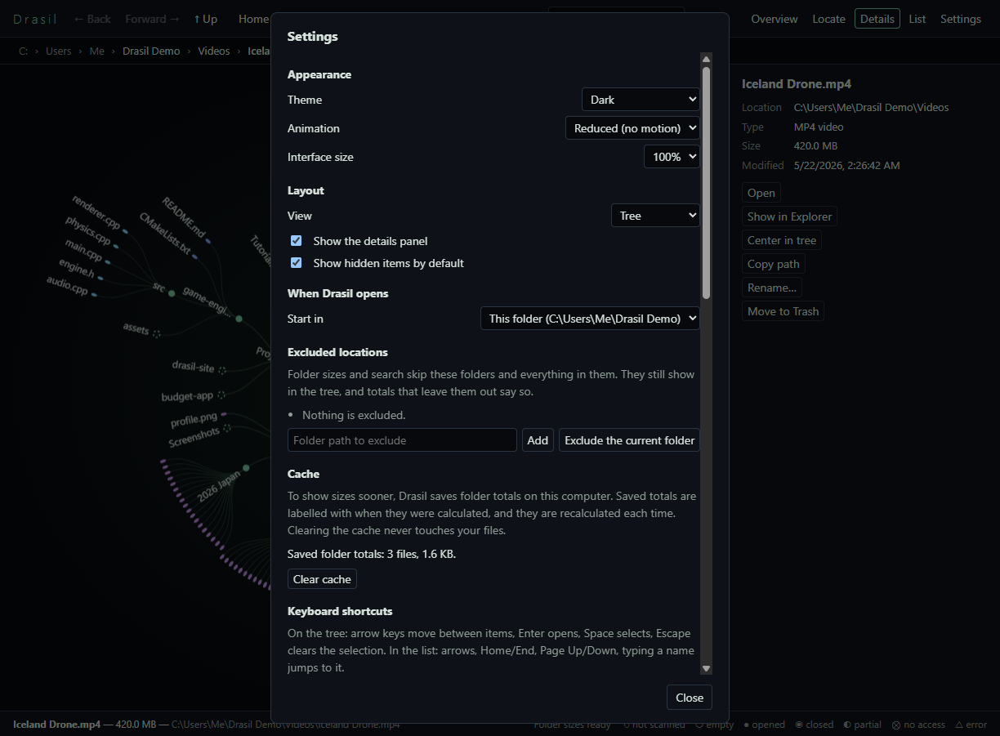

<div align="center">


# DRASIL

**A living world for your files.**

A private, offline file manager that turns your folders into an interactive radial tree.<br />
Folders are branches, files are leaves. See the shape of your whole drive, then zoom in and manage your files right there.

[](https://github.com/YassineBenZriouil/DRASIL/releases/latest)
[](https://github.com/YassineBenZriouil/DRASIL/releases)
[](https://github.com/YassineBenZriouil/DRASIL/actions/workflows/ci.yml)
[](LICENSE)
<br />
[](#-download)
[](docs/PRIVACY.md)
[](docs/PRIVACY.md)
[](docs/USER-GUIDE.md#list-view-and-accessibility)

[**Download**](https://github.com/YassineBenZriouil/DRASIL/releases/latest) ·
[**User guide**](docs/USER-GUIDE.md) ·
[**Privacy**](docs/PRIVACY.md) ·
[**Report a bug**](https://github.com/YassineBenZriouil/DRASIL/issues/new?labels=bug)

<br />



</div>

<br />

## ✨ Highlights

<table>
<tr>
<td width="50%" valign="top">

### 🌳 See the whole shape

Your files grow outward from the center as a tree you can pan and zoom. Big and deeply nested folders stand out at a glance. Crowded folders gather into a band until you zoom in, so even a million files stay smooth.

</td>
<td width="50%" valign="top">

### 🗂️ A real file manager

Open, rename, create, move by drag and drop, copy, cut and paste, and send to the Trash. All of it happens right in the tree, for one item or many.

</td>
</tr>
<tr>
<td valign="top">

### 🔍 Find anything

Search streams results as it goes, closest folders first, and always tells you how much it actually searched. Filter by type, size or date, and highlight the largest or oldest items.

</td>
<td valign="top">

### 🛡️ Careful with your data

It never overwrites without asking. "Replace" sends the old item to the Trash first. A folder can't be moved into itself, and a move between drives deletes the original only after a complete copy.

</td>
</tr>
<tr>
<td valign="top">

### ♿ Built for everyone

Every action works from the keyboard, and all shortcuts can be changed. A list view works with screen readers. There are light and dark themes, an interface size from 75% to 200%, and reduced motion.

</td>
<td valign="top">

### 🔒 Private by design

No account, no telemetry, no internet needed. Your file names never leave your computer, and the app blocks any network request it didn't expect.

</td>
</tr>
</table>

## 📸 Screenshots

<table>
<tr>
<td width="50%"></td>
<td width="50%"></td>
</tr>
<tr>
<td align="center"><b>List view</b> works with the keyboard and screen readers, and stays in sync with the tree</td>
<td align="center"><b>Search</b> shows results as they're found and says how much was searched</td>
</tr>
<tr>
<td></td>
<td></td>
</tr>
<tr>
<td align="center"><b>Filters and discovery</b>: find what's taking up space</td>
<td align="center"><b>Light theme</b>, both themes checked for WCAG AA contrast</td>
</tr>
<tr>
<td></td>
<td></td>
</tr>
<tr>
<td align="center"><b>First launch</b>: pick a place and you're in. No tutorial.</td>
<td align="center"><b>Settings</b>: appearance, layout, exclusions, cache and shortcuts</td>
</tr>
</table>

## 📥 Download

Grab the latest version from **[Releases](https://github.com/YassineBenZriouil/DRASIL/releases/latest)**:

| Platform       | Download                                                              | Notes                              |
| -------------- | --------------------------------------------------------------------- | ---------------------------------- |
| 🪟 **Windows** | `Drasil-<version>-win-x64.exe` · `-arm64.exe`                         | Windows 10 and 11, no admin needed |
| 🍎 **macOS**   | `Drasil-<version>-mac-arm64.dmg` (Apple silicon) · `-x64.dmg` (Intel) | macOS 12+, signed and notarized    |
| 🐧 **Linux**   | `.AppImage` · `.deb` · `.rpm`                                         | AppImage runs on any distribution  |

Updates never install themselves. Drasil checks only when you ask (or weekly if you turn that on) and asks before downloading anything.

## 🚀 Quick start

1. **Open Drasil** and pick where to start: Home, Documents, a drive…
2. **Click a folder** to open it. Drag to move around, and scroll or pinch to zoom.
3. **Right-click** anything for actions, or press **F1** for every shortcut.

<details>
<summary><b>⌨️ Handy shortcuts</b></summary>

<br />

Ctrl means Cmd on macOS.

| Action                         | Keys                                                         |
| ------------------------------ | ------------------------------------------------------------ |
| Search                         | <kbd>Ctrl</kbd> + <kbd>F</kbd>                               |
| Back / Forward / Parent folder | <kbd>Alt</kbd> + <kbd>←</kbd> / <kbd>→</kbd> / <kbd>↑</kbd>  |
| See the whole tree             | <kbd>Home</kbd>                                              |
| Move around the tree           | <kbd>↑</kbd> <kbd>↓</kbd> <kbd>←</kbd> <kbd>→</kbd>          |
| Rename                         | <kbd>F2</kbd>                                                |
| Copy / Cut / Paste             | <kbd>Ctrl</kbd> + <kbd>C</kbd> / <kbd>X</kbd> / <kbd>V</kbd> |
| Move to Trash                  | <kbd>Delete</kbd> (Mac: <kbd>⌘</kbd> + <kbd>⌫</kbd>)         |
| List view                      | <kbd>L</kbd>                                                 |
| All shortcuts                  | <kbd>F1</kbd>                                                |

Every shortcut can be changed in Settings → Keyboard shortcuts.

</details>

## 🔒 Privacy

> [!NOTE]
> Drasil works entirely on your computer. It never sends file names, paths, contents, usage data or crash reports anywhere: no telemetry, no analytics, no account. The only time it goes online is an update check you start yourself. [Read the details →](docs/PRIVACY.md)

## 🛠️ Build from source

Requires **Node.js 24+**.

```sh
git clone https://github.com/YassineBenZriouil/DRASIL.git
cd DRASIL
npm install
npm run dev        # run with hot reload
```

<details>
<summary><b>More commands</b></summary>

<br />

| Command                                    | What it does                                  |
| ------------------------------------------ | --------------------------------------------- |
| `npm run build`                            | Build the app into `out/`                     |
| `npm start`                                | Run the built app                             |
| `npm run dist`                             | Build installers for your platform in `dist/` |
| `npm run dist:dir`                         | Build an unpacked app in `dist/`              |
| `npm run typecheck`                        | Type-check                                    |
| `npm run lint`                             | Lint                                          |
| `npm run format`                           | Format with Prettier                          |
| `npm run make-test-tree -- <empty folder>` | Create a 1M-file tree for performance checks  |

</details>

**Built with** [Electron](https://www.electronjs.org/), [TypeScript](https://www.typescriptlang.org/) and [electron-vite](https://electron-vite.org/). The tree is drawn on a plain Canvas 2D with level-of-detail rendering. Folder reading, size calculation and search run in worker threads, so the window never waits on the disk.

## 📚 Documentation

| Document                                | What's in it                                                        |
| --------------------------------------- | ------------------------------------------------------------------- |
| [User guide](docs/USER-GUIDE.md)        | Getting started, shortcuts, what Drasil reads, platform differences |
| [Privacy](docs/PRIVACY.md)              | Exactly what is (and isn't) stored or sent                          |
| [Technical notes](docs/TECHNICAL.md)    | Architecture, design decisions and their reasons                    |
| [Product vision](docs/NON-TECHNICAL.md) | What Drasil is meant to be, and never become                        |
| [Releasing](docs/RELEASING.md)          | Signing, publishing and the launch checklist                        |

## 🤝 Contributing and feedback

Found a bug or have an idea? [Open an issue](https://github.com/YassineBenZriouil/DRASIL/issues). The quickest way to report a bug is from the app itself: **Settings → About → Report a bug** fills in your version and system for you.

## 📄 License

Drasil is free and open source under the [MIT License](LICENSE).

<div align="center">
<br />
<sub>Made for people who'd rather see their files than scroll through them.</sub>
</div>
